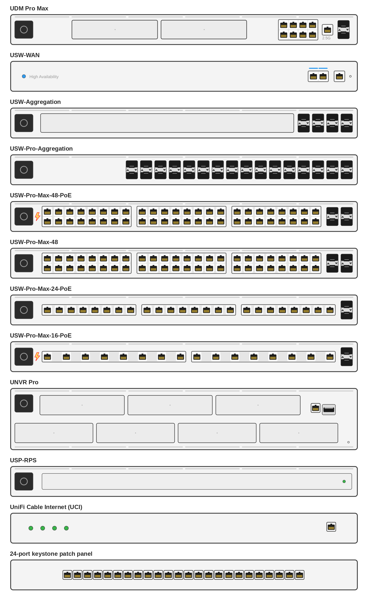

# UniFi rack gear stencils for draw.io

Flat vector front panels of UniFi rack equipment, drawn for network and rack diagrams in
[draw.io](https://www.drawio.com) (diagrams.net). Every face is a true vector SVG on a common
1000 x 90 unit grid (2U gear is 1000 x 180), so they line up in a rack elevation and stay sharp
at any zoom.



## What's included

| Model | SVG | Editable source |
|---|---|---|
| UDM Pro Max | `svg/udm-pro-max.svg` | `drawio/udm-pro-max.drawio` |
| USW-WAN | `svg/usw-wan.svg` | `drawio/usw-wan.drawio` |
| USW-Aggregation | `svg/usw-aggregation.svg` | `drawio/usw-aggregation.drawio` |
| USW-Pro-Aggregation | `svg/usw-pro-aggregation.svg` | `drawio/usw-pro-aggregation.drawio` |
| USW-Pro-Max-48-PoE | `svg/pro-max-48-poe.svg` | `drawio/pro-max-48-poe.drawio` |
| USW-Pro-Max-48 | `svg/pro-max-48.svg` | `drawio/pro-max-48.drawio` |
| USW-Pro-Max-24-PoE | `svg/pro-max-24-poe.svg` | `drawio/pro-max-24-poe.drawio` |
| USW-Pro-Max-16-PoE | `svg/pro-max-16-poe.svg` | `drawio/pro-max-16-poe.drawio` |
| UNVR Pro (2U) | `svg/unvr-pro.svg` | `drawio/unvr-pro.drawio` |
| USP-RPS | `svg/rps.svg` | `drawio/rps.drawio` |
| UniFi Cable Internet (UCI) | `svg/uci.svg` | `drawio/uci.drawio` |
| 24-port keystone patch panel | `svg/patch.svg` | `drawio/patch.drawio` |
| SFP+ port pair (building block) | `svg/sfp-pair.svg` | `drawio/sfp-pair.drawio` |

## Using them in draw.io

**As a library (easiest):** in draw.io choose *File > Open Library from > Device* (or *URL*) and
pick `library/unifi-rack-gear.xml`. All the faces show up in the left sidebar; drag them onto the
canvas. The raw URL works too:

```
https://raw.githubusercontent.com/CaptainVirgil/unifi-drawio-stencils/main/library/unifi-rack-gear.xml
```

**As images:** drop any file from `svg/` onto the canvas, or reference it from a shape style with
`shape=image;image=<url>`.

**To change a face:** open the matching file in `drawio/`. Each one is built from native draw.io
cells (chassis, vent strip, display, grouped port banks, individual RJ45 jacks, SFP pairs), so
you can move or recolor any part. Export it back to a clean SVG with:

```
python3 tools/drawio_to_svg.py drawio/pro-max-48.drawio svg/pro-max-48.svg
```

The converter has no dependencies beyond the Python standard library.

## Design rules

These are what keep the set consistent if you add your own:

- **RJ45:** one fixed size across every device, drawn square and centered, dark cavity with the
  gold contacts on the bottom. Jacks inside a port bank share one bezel instead of each having
  its own outline.
- **Port banks** follow the real panel layout: 48-port switches are two rows in three groups,
  24-port is one row in three groups, 16-port is one row.
- **SFP+** ports are a stacked pair tile at one fixed scale, never stretched.
- **Vent strip** across the top of gear that has one. The WAN switch, patch panel and UCI don't.

## License

The artwork (`svg/`, `drawio/`, `library/`, `preview.png`) is licensed under
[CC BY 4.0](https://creativecommons.org/licenses/by/4.0/). Use it anywhere, including commercial
work, with credit. The converter in `tools/` is MIT licensed. See [LICENSE](LICENSE).

UniFi, UDM and the product names above are trademarks of Ubiquiti Inc. This project is not
affiliated with or endorsed by Ubiquiti. These are original drawings, not Ubiquiti artwork.
